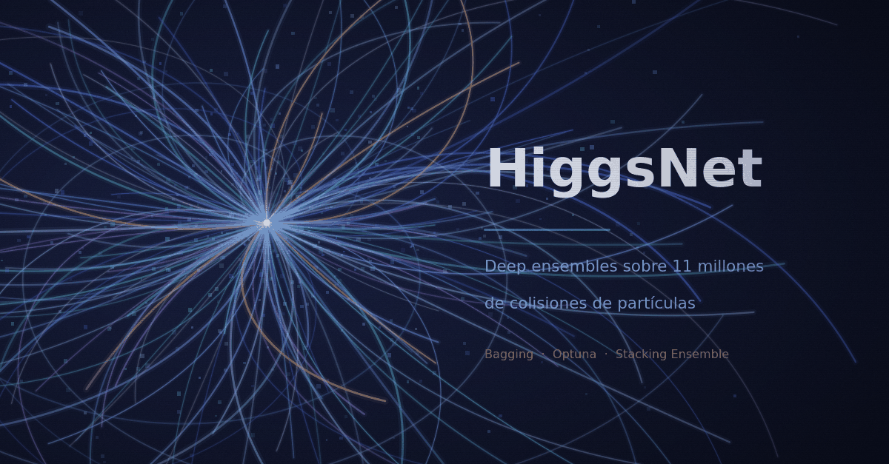

<p align="center">
  
</p>

# Laboratorio 1 — Aprendizaje Profundo a Gran Escala y Ensembles

Curso: **Fundamentos de Aprendizaje Profundo y Aplicaciones** — Semestre 2-2026
Profesor: Francisco Muñoz (`francisco.munoz.b@usach.cl`)
Entrega: **22 de noviembre de 2026** por correo, con asunto `Lab 1 - DL - 6`

| | |
|---|---|
| N° de grupo | **6** |
| Integrante | **Cristopher Angulo Ahumada** (trabajo individual) |
| Opción de problema | **B — Predicción Científica / Series de Sensores Industriales** |
| Dataset | **HIGGS Boson Dataset** — [UCI ML Repository, id 280](https://archive.ics.uci.edu/dataset/280/higgs) |
| Tarea | Clasificación binaria: señal (bosón de Higgs) vs. fondo |
| Volumen | 11.000.000 de filas disponibles → **submuestra aleatoria de 1.000.000** |
| Dimensionalidad | 28 features originales → **51 tras el feature engineering** de la Fase B |
| Modelos base | **3** (el enunciado exige 2 a 3 para un grupo de 1 integrante) |
| Estado | ✅ **Completo** — los tres notebooks ejecutados de principio a fin |

> **Sobre el requisito de ≥ 40 columnas.** HIGGS aporta 28 features, por debajo del mínimo que
> fija el enunciado. El profesor autorizó expresamente usarlo así, dado que el volumen de
> observaciones compensa la menor dimensionalidad, y el propio enunciado lista
> "HIGGS Boson Dataset (200k-1M)" como ejemplo de la Opción B. Además, el *feature engineering*
> de la Fase B construye 23 variables derivadas y eleva el conjunto a **51 características**, con
> lo que el mínimo queda satisfecho antes del entrenamiento.

## Resultados

Evaluación final sobre un conjunto de Test de **150.000 eventos** que no intervino en ninguna
etapa del desarrollo: ni en el entrenamiento de los modelos base, ni en su *early stopping*, ni en
la búsqueda de hiperparámetros, ni en el ajuste de la meta-red.

| Predictor | ROC-AUC | PR-AUC | F1 | Exactitud |
|---|---|---|---|---|
| Modelo base 1 — `512-256-128` | 0,85316 | 0,86499 | 0,77918 | 76,92 % |
| Modelo base 2 — `256-128-64` | 0,84880 | 0,86094 | 0,77860 | 76,43 % |
| Modelo base 3 — `128-64` | 0,83279 | 0,84582 | 0,75891 | 74,97 % |
| Promedio simple | 0,85282 | 0,86469 | 0,78046 | 76,89 % |
| **Stacking** | **0,85572** | **0,86763** | **0,78115** | **77,13 %** |

El hallazgo central no es la ganancia del ensamble sino el fracaso de la alternativa ingenua:
**el promedio simple quedó por debajo del mejor modelo individual** (0,85282 frente a 0,85316).
Dar un tercio del voto a `base_3`, dos centésimas peor que `base_1`, resta más de lo que la
diversidad de los otros dos aporta. En un ensamble de miembros desiguales, aprender los pesos no
es un refinamiento opcional: es lo que separa mejorar de empeorar.

La meta-red ordenó a los tres modelos **exactamente según su competencia individual**, sin que esa
información se le proporcionara:

| Modelo | Peso aprendido | ROC-AUC individual |
|---|---|---|
| base_1 | **+0,6401** | 0,85341 |
| base_2 | **+0,4547** | 0,84993 |
| base_3 | **−0,0493** | 0,83332 |

El peso negativo de `base_3` no es un defecto: la meta-red lo emplea como **corrector** y no como
votante, relación que un promedio simple no puede expresar. Todo ello con 4 parámetros entrenables
frente a 262.019 congelados —el 0,0015 % del total—, ajustados en 11 segundos.

**Costo total:** 32 minutos de cómputo en CPU (sin GPU) y un pico de memoria de 1,35 GB, frente a
los 7,5 GB que ocupa el archivo descomprimido y al presupuesto de 12 a 24 horas del enunciado.

## Notebooks

Los tres corresponden a fases secuenciales del pipeline y se ejecutan en orden; cada uno consume
los artefactos que deja el anterior.

| Notebook | Contenido | Tiempo |
|---|---|---|
| [`01_EDA_y_Preprocessing.ipynb`](notebooks/01_EDA_y_Preprocessing.ipynb) | Descarga y lectura por bloques del `.csv.gz` de 2,6 GB, submuestra de 1M filas, particiones estratificadas con `StandardScaler` sin *data leakage*, auditoría con `ydata-profiling compare`, EDA sobre el 10 % y análisis no supervisado (PCA / t-SNE / K-Means) | ~6 min |
| [`02_Modelos_Base.ipynb`](notebooks/02_Modelos_Base.ipynb) | 23 variables derivadas de la cinemática (51 en total), búsqueda con **Optuna** sobre el 20 % de los datos con *pruning*, y **3 modelos base** entrenados con muestreo Bootstrap al 100 % | ~32 min |
| [`03_Stacking_Ensemble_Final.ipynb`](notebooks/03_Stacking_Ensemble_Final.ipynb) | Reconstrucción de los modelos desde sus checkpoints, **meta-red de Stacking con pesos entrenables** sobre Validación, y evaluación sobre Test con matriz de confusión, curvas ROC/PR y análisis de umbral | ~3 min |

`00_codigo_base_profesor.ipynb` es el notebook de ejemplo entregado por el profesor, sin outputs,
y se conserva solo como referencia.

**Condición estricta del enunciado:** los notebooks se entregan completamente ejecutados, con
todas las salidas visibles. El profesor no los re-ejecuta; la revisión se hace sobre lo ya
generado.

## Estructura del repositorio

```
Lab1-DL/
├── notebooks/
│   ├── 00_codigo_base_profesor.ipynb    # Notebook de ejemplo, sin outputs (referencia)
│   ├── 01_EDA_y_Preprocessing.ipynb     # Fase A — ejecutado
│   ├── 02_Modelos_Base.ipynb            # Fase B — ejecutado
│   └── 03_Stacking_Ensemble_Final.ipynb # Fase C — ejecutado
├── src/
│   └── lab_base.py        # Código base del profesor extraído a módulo reutilizable
├── checkpoints/           # Pesos .pt del ensamble (versionados: 1,1 MB)
├── docs/
│   ├── enunciado_laboratorio_1.pdf
│   ├── REFERENCIAS.md     # Bibliografía verificada, con el uso de cada entrada
│   └── informe/
│       ├── informe_lab1.tex
│       └── informe_lab1.pdf   # Informe de 17 páginas
├── reports/               # Evidencia del informe, versionada
│   ├── profiling/         # .html de ydata-profiling (compare train/val/test)
│   ├── figures/           # 12 figuras: EDA, PCA/t-SNE, curvas, matriz de confusión
│   └── tables/            # Comparación final de predictores en Test (.csv)
├── data/                  # Datasets (ignorados por git)
├── assets/                # Banners y sus generadores
│   ├── higgsnet_banner_lofi.png   # Banner actual
│   └── higgsnet_banner.png        # Primera versión, conservada
└── requirements.txt
```

### Dónde queda cada artefacto

| Tipo | Drive | Repositorio (GitHub) |
|---|---|---|
| Submuestra `.parquet` (62,6 MB) | ✅ | ❌ se regenera |
| Splits escalados `.npz` (205 MB) | ✅ | ❌ excede el límite de 100 MB por archivo de GitHub |
| Pesos `.pt` del ensamble (1,1 MB) | ✅ | ✅ **versionados**, para que el notebook 03 sea reproducible |
| Figuras, tablas y reporte de profiling | ✅ copia de respaldo | ✅ **versionadas** |

La evidencia del informe se guarda en **los dos** destinos. El repositorio es el primario —es lo
que se versiona y por donde se revisa el trabajo— y la copia a Drive la hace la función
`espejar()`, archivo por archivo en el momento de escribirlo, de modo que una interrupción no deje
el respaldo incompleto.

Los datos procesados viven solo en Drive porque se regeneran de forma determinista a partir del
código y las semillas fijadas, y porque el archivo de particiones excede por sí solo el límite de
GitHub. Los **pesos sí se versionan** pese a regenerarse también: sin ellos el notebook 03 no es
ejecutable por quien clone el repositorio, ya que los checkpoints que carga viven en el Drive del
autor.

El `.csv.gz` de 2,6 GB del dataset se descarga siempre a disco local y no se sincroniza a Drive:
es un insumo temporal que se lee una sola vez.

## Cómo reproducir

Los notebooks detectan solos el entorno y se adaptan a tres escenarios sin modificar una línea:

| Escenario | Destino de los artefactos pesados |
|---|---|
| **Google Colab** | Google Drive, montado en `/content/drive` |
| **Local con Google Drive para escritorio** | La unidad sincronizada (`G:\Mi unidad\Lab1-DL`) |
| **Local sin Drive** | El propio repositorio, en carpetas excluidas por `.gitignore` |

```bash
pip install -r requirements.txt
jupyter lab notebooks/01_EDA_y_Preprocessing.ipynb
```

La primera celda de cada notebook comprueba las dependencias e instala solo las que falten. El
notebook 01 descarga los 2,6 GB del dataset si no están en disco.

Para verificar los resultados del ensamble **sin repetir el entrenamiento**, basta ejecutar el
notebook 03: carga los pesos versionados en `checkpoints/`, que incluyen la configuración de
arquitectura de cada modelo.

## Reglas de supervivencia en Colab (obligatorias según el enunciado)

- EDA y análisis no supervisado **sobre una submuestra del 10 %**, no sobre el dataset completo.
- `ydata-profiling` con `ProfileReport(..., minimal=True)` y sobre submuestras (≤ 10.000 filas por
  split); exportar el `compare([train, val, test])` a `.html` en `reports/profiling/`.
- Búsqueda de hiperparámetros sobre el 10-20 % de los datos; entrenamiento final con el 100 %.
- Formatos comprimidos (`.parquet` en vez de `.csv`), `del` + `gc.collect()` tras cada paso.
- Montar Google Drive y guardar los checkpoints ahí para sobrevivir a las desconexiones.

## Rúbrica (60 puntos)

| Ítem | Puntos | Dónde se cubre |
|---|---|---|
| 1. Preparación de datos, memoria y EDA | 10 | Notebook 01 |
| 2. Adaptación de la arquitectura base y métricas | 10 | Notebooks 01 y 02 |
| 3. Entrenamiento progresivo e integración en la nube | 15 | Notebook 02 |
| 4. Ensamblaje avanzado (Bagging + Stacking adaptativo) | 15 | Notebooks 02 y 03 |
| 5. Análisis de resultados, discusión y conclusiones | 10 | Notebook 03 e [informe](docs/informe/informe_lab1.pdf) |

## Entregables enviados

- Los **tres notebooks** `.ipynb`, ejecutados de principio a fin.
- `comparacion_particiones.html` — evidencia de la auditoría con `ydata-profiling`.
- `informe_lab1.pdf` — informe de 17 páginas (adicional, no exigido por el enunciado).

El análisis escrito que confirma la homogeneidad de las particiones y la ausencia de *data
leakage* está dentro del notebook 01, acompañando a la auditoría.

## Referencias

La bibliografía completa, con el detalle de dónde se usa cada entrada, está en
[`docs/REFERENCIAS.md`](docs/REFERENCIAS.md). Las 23 variables construidas en la Fase B no
provienen de una lista publicada: son construcciones estándar de la física de colisionadores
—separación angular ΔR, cocientes de masas invariantes, etiquetado de sabor pesado— aplicadas a
las magnitudes que el dataset ya provee, y las referencias documentan el origen canónico de cada
una.
