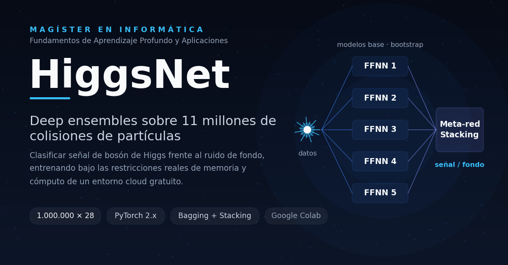

<p align="center">
  
</p>

# Laboratorio 1 — Aprendizaje Profundo a Gran Escala y Ensembles

Curso: **Fundamentos de Aprendizaje Profundo y Aplicaciones** — Semestre 2-2026
Profesor: Francisco Muñoz (`francisco.munoz.b@usach.cl`)
Entrega: **22 de noviembre de 2026** (prórroga; el enunciado en `docs/` aún dice 17 de noviembre)
— por correo, con asunto `Lab 1 - DL - [NUMERO GRUPO]`

> **Por definir:** número de grupo, integrantes y dataset elegido. Completar la tabla de abajo
> antes de la entrega.

| | |
|---|---|
| N° de grupo | _por definir_ |
| Integrantes | _por definir_ |
| Opción de problema | **B — Predicción Científica / Series de Sensores Industriales** |
| Dataset | **HIGGS Boson Dataset** — [UCI ML Repository, id 280](https://archive.ics.uci.edu/dataset/280/higgs) |
| Tarea | Clasificación binaria: señal (bosón de Higgs) vs. fondo |
| Volumen | 11.000.000 de filas disponibles → se usa una **submuestra aleatoria de 1.000.000** |
| Dimensionalidad | **28 features** (21 cinemáticas de bajo nivel + 7 masas invariantes de alto nivel) |
| Modelos base exigidos | _según tamaño del grupo: 1 → 2-3, 2 → 4-5, 3 → 6-8_ |

> **Nota sobre el requisito de ≥ 40 columnas:** HIGGS tiene 28 features, por debajo del mínimo
> que fija el enunciado. El profesor autorizó expresamente usarlo así, dado que el volumen de
> observaciones (11M disponibles) compensa la menor dimensionalidad. Además, el propio enunciado
> lista "HIGGS Boson Dataset (200k-1M)" como ejemplo de la Opción B.

## Objetivo

Adaptar el código base de PyTorch entregado por el profesor (FFNN con BatchNorm/Dropout,
AdamW + Early Stopping, Bagging Bootstrap y Stacking Ensemble) para resolver un problema
tabular **masivo** (200.000 a 1.000.000 de filas, ≥ 40 columnas) bajo las restricciones de
memoria y cómputo de Google Colab (~12 GB de RAM, 12-24 h de entrenamiento acumulado).

## Estructura del repositorio

```
Lab1-DL/
├── docs/                  # Enunciado del laboratorio (PDF)
├── notebooks/
│   ├── 00_codigo_base_profesor.ipynb   # Notebook de ejemplo, sin outputs (referencia)
│   └── 01_EDA_y_Preprocessing.ipynb    # Fase A: carga 1M filas, splits y EDA (listo para Colab)
├── src/
│   └── lab_base.py        # Mismo código base extraído a módulo reutilizable
├── data/                  # Datasets (ignorados por git)
├── checkpoints/           # Pesos .pt / best_model.pt (ignorados por git)
├── reports/
│   ├── profiling/         # .html de ydata-profiling (compare train/val/test)
│   └── figures/           # Curvas de loss, matrices de confusión, PCA/t-SNE
└── requirements.txt
```

### Notebooks de entrega (a crear)

El enunciado permite entregar uno o varios `.ipynb`. Plan:

1. ✅ `01_EDA_y_Preprocessing.ipynb` — descarga por *chunks*, submuestra de 1M filas, splits
   estratificados + `StandardScaler` sin data leakage, auditoría con `ydata-profiling compare`,
   EDA sobre el 10% y análisis no supervisado (PCA / t-SNE / K-Means). **Falta ejecutarlo en Colab.**
2. ⬜ `02_Modelos_Base.ipynb` — búsqueda progresiva de hiperparámetros (10-20% de los datos),
   entrenamiento final de los M modelos base con Bootstrap, checkpoints en Drive.
3. ⬜ `03_Stacking_Ensemble_Final.ipynb` — meta-red de Stacking, evaluación en test, conclusiones.

### Cómo ejecutar el notebook 01

Súbelo a Google Colab (`Archivo → Subir notebook`), activa GPU en
`Entorno de ejecución → Cambiar tipo de entorno` y ejecuta las celdas en orden. Escribe todos sus
artefactos en `MyDrive/Lab1-DL/`. Tiempo estimado: 25-45 min, dominado por la descarga de los
2.6 GB y la lectura por bloques del `.csv.gz`.

**Condición estricta del enunciado:** los notebooks se entregan **completamente ejecutados**
(todas las salidas visibles). El profesor no los re-ejecuta.

## Reglas de supervivencia en Colab (obligatorias según el enunciado)

- EDA y análisis no supervisado **sobre una submuestra del 10%**, no sobre el dataset completo.
- `ydata-profiling` con `ProfileReport(..., minimal=True)` y sobre submuestras (≤ 10.000 filas
  por split); exportar el `compare([train, val, test])` a `.html` en `reports/profiling/`.
- Búsqueda de hiperparámetros sobre el 10-20% de los datos; entrenamiento final con el 100%.
- Formatos comprimidos (`.parquet` en vez de `.csv`), `del` + `gc.collect()` tras cada paso.
- Montar Google Drive y guardar `best_model.pt` ahí (`ckpt_path`) para sobrevivir desconexiones.

## Rúbrica (60 puntos)

| Ítem | Puntos |
|---|---|
| 1. Preparación de datos, memoria y EDA | 10 |
| 2. Adaptación de la arquitectura base y métricas | 10 |
| 3. Entrenamiento progresivo e integración en la nube | 15 |
| 4. Ensamblaje avanzado (Bagging + Stacking adaptativo) | 15 |
| 5. Análisis de resultados, discusión y conclusiones | 10 |

## Entregables al correo

- Notebook(s) `.ipynb` ejecutados de principio a fin.
- Archivo `.html` de la comparación de particiones con `ydata-profiling`.
- Análisis escrito que confirme homogeneidad de particiones y ausencia de *data leakage*.
